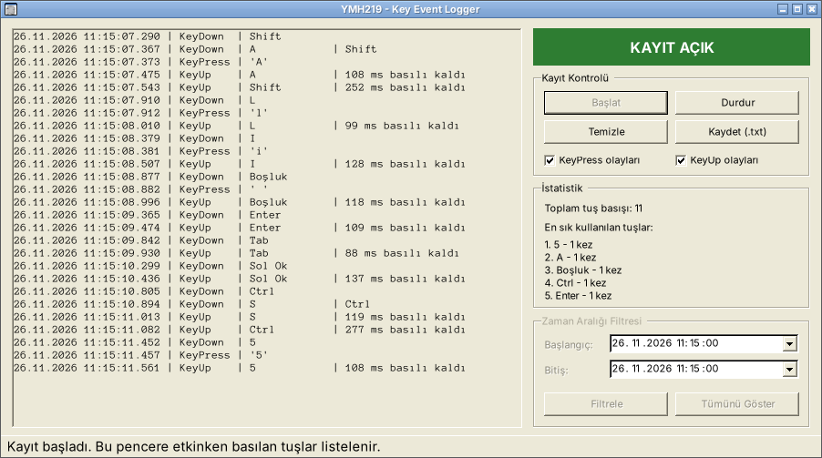
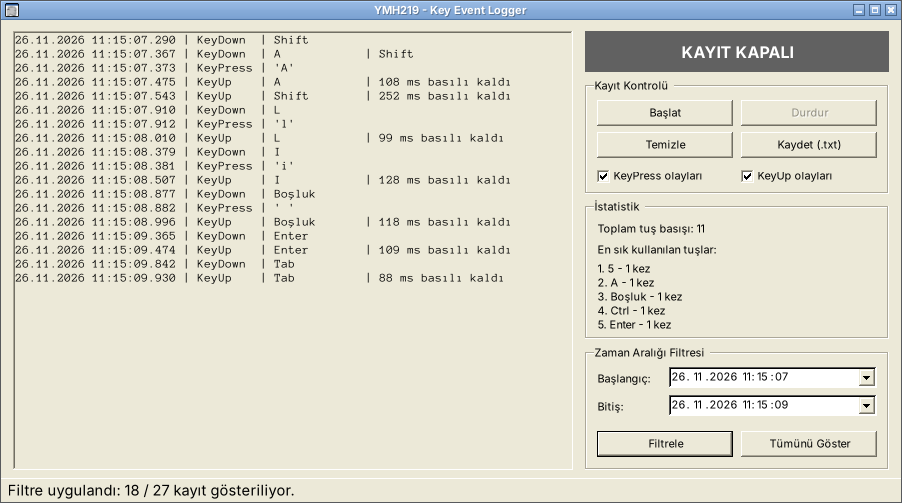

# YMH219-KeyEventLogger

Klavye olaylarının (KeyDown, KeyPress, KeyUp) nasıl yakalandığını ve işlendiğini gösteren eğitsel bir Windows Forms uygulaması. Uygulama penceresi etkinken basılan tuşları zaman bilgisiyle listeler ve istenirse kayıtları yerel bir metin dosyasına kaydeder.

Nesne Tabanlı Programlama (YMH 219) dersi ek uygulama ödevidir.

## Kapsam ve Güvenlik Sınırı

Bu uygulama gerçek bir sistem keylogger'ı değildir.

- Yalnızca kendi penceresi etkinken (odaktayken) tuşları görür. Olaylar formun kendi `KeyDown`, `KeyPress` ve `KeyUp` olaylarından gelir.
- Global klavye kancası (hook) kullanmaz; başka uygulamalarda basılan tuşları yakalayamaz.
- Gizli veya arka planda çalışmaz, başlangıçta otomatik açılmaz.
- Kayıtları ağ üzerinden göndermez. Dosyaya kaydetme yalnızca kullanıcı **Kaydet** düğmesine bastığında, kullanıcının seçtiği konuma yapılır.
- Kayıt durumu ekranda her zaman açıkça gösterilir.

## Kullanılan Teknolojiler

- C# / .NET, Windows Forms
- Harici NuGet paketi kullanılmamıştır.

## Kurulum ve Çalıştırma

1. Depoyu klonlayın:
   ```bash
   git clone https://github.com/KULLANICI_ADI/YMH219-KeyEventLogger.git
   ```
2. `YMH219-KeyEventLogger.sln` dosyasını Visual Studio ile açın.
3. **F5** ile çalıştırın.

Gereksinimler: Windows ve Visual Studio (.NET masaüstü geliştirme iş yükü).

## Kullanım

1. **Başlat** düğmesine basın. Gösterge yeşile döner ve "KAYIT AÇIK" yazar.
2. Pencere etkinken klavyeden tuşlara basın. Her olay zamanıyla birlikte listeye eklenir.
3. **Durdur** ile kaydı durdurun. Kayıt kapalıyken basılan tuşlar listeye eklenmez.
4. **Kaydet (.txt)** ile ekrandaki kayıtları bir metin dosyasına kaydedin.
5. **Temizle** ile ekrandaki kayıtları ve istatistiği silin.
6. Kayıt durmuşken **Zaman Aralığı Filtresi** ile yalnızca belirli bir aralıktaki kayıtları görüntüleyin.

Kayıt satırı biçimi:

```
26.11.2026 10:50:12.345 | KeyDown  | C            | Shift
26.11.2026 10:50:12.348 | KeyPress | 'C'
26.11.2026 10:50:12.440 | KeyUp    | C            | 95 ms basılı kaldı
```

## Temel Özellikler

- Basılan tuşun adını ve zamanını milisaniye hassasiyetinde listeleme
- Başlat ve Durdur düğmeleriyle kayıt durumunu kontrol etme
- Renkli kayıt durumu göstergesi: kayıt açık (yeşil), kayıt kapalı (gri), kayıt açık ama pencere etkin değil (turuncu)
- Temizle düğmesi, kaydedilmemiş kayıtlar için onay sorusu
- Kayıtları `.txt` dosyasına kaydetme (UTF-8)
- KeyPress ve KeyUp olaylarını isteğe bağlı açıp kapatma; KeyUp satırında tuşun basılı kalma süresi
- İstatistik: toplam tuş basışı ve en sık kullanılan beş tuş
- Kayıtları tarih ve saat aralığına göre filtreleme
- Tab, Enter, Esc ve ok tuşları dahil tüm tuşların kaydedilmesi

## Proje Yapısı

| Dosya | Görevi |
|---|---|
| `Form1.cs` | Arayüz olayları; klavye olaylarını kayıt sınıfına iletir |
| `KeyEventLog.cs` | Kayıt durumu, kayıt listesi, istatistik ve filtreleme |
| `KeyEventRecord.cs` | Tek bir kayıt ve satır biçimi |
| `KeyEventType.cs` | Olay türleri (KeyDown, KeyPress, KeyUp) |
| `KeyNameFormatter.cs` | Tuş kodlarını okunabilir adlara çevirir |
| `LogFileWriter.cs` | Kayıtları metin dosyasına yazar |

## Ekran Görüntüleri





## Bilinen Sınırlamalar ve Geliştirme Notları

- Bir tuş basılı tutulduğunda klavyenin ürettiği tekrar eden KeyDown olayları tek basış sayılır; KeyPress ise üretilen her karakter için ayrı kaydedilir.
- Harf dışındaki bazı tuşlar klavye düzeninden bağımsız kod adlarıyla görünür (örneğin `Oemcomma`). Üretilen karakter KeyPress satırında yer alır.
- Print Screen gibi bazı tuşlar için Windows yalnızca KeyUp olayı gönderir.
- Kayıt açıkken tuşlar düğmelere iletilmez; arayüz fareyle kullanılır. Alt+F4 çalışmaya devam eder.
- Kayıtlar yalnızca bellekte tutulur; kaydedilmeden uygulama kapatılırsa silinir.
- Zaman filtresi saniye hassasiyetindedir.

## Öğrenci

Ad Soyad - Öğrenci No
